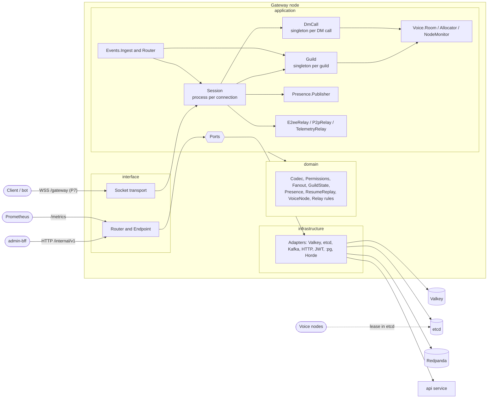

# Gateway architecture

Clean Architecture: dependencies point inwards. `domain` is pure, `application` holds the
processes and use cases and talks to the outside only through ports, `infrastructure` implements
the ports, `interface` is HTTP and WebSocket. The composition root binds ports to adapters
(`config/config.exs`) and starts the tree; tests rebind the ports to in-memory fakes.

```
lib/discordy_gateway/
  contracts.ex          pinned constants (opcodes, close codes, intents, permissions, topics, keys)
  domain/               codec, intents, permissions, guild cache, fan-out plan, presence aggregation,
                        resume replay, rate limiter, dedup LRU, voice states and node selection,
                        relay rules
  application/          Session, Guild, DmCall, Voice.{Room,Allocator,NodeMonitor,DrainNode},
                        Events.{Ingest,Router,Deduplicator}, Presence.Publisher,
                        Relay.{E2eeRelay,P2pRelay,TelemetryRelay,InboxSweeper}, Stats, UsageTicker,
                        ports/ (behaviours)
  infrastructure/       Valkey, etcd, Kafka (brod), HTTP api client, JWT/HS256/TURN, :pg, Horde, config
  interface/            Endpoint, Router, Socket (WebSock), health, metrics, internal auth
  composition_root.ex   OTP application
```

## C4 component diagram



## Processes

- **Session** (`DynamicSupervisor`, one per connection, `:temporary`). The WebSocket process is a
  transport only; it forwards parsed frames and writes the `{:gw_frame, _}` and `{:gw_close, _}`
  messages the session sends back. The session survives a dropped socket for 120 s. Every
  dispatch is numbered and appended to the Valkey list `gw:resume:<id>` (capped at 1000);
  RESUME from a new connection starts a short-lived stub session that calls the original
  session (`{:resume, ...}`, cluster-wide through `:pg`), which re-attaches the new transport,
  replays the missed frames and then sends RESUMED. The stub forwards later frames to it.
  Payloads are encoded once into one binary that all recipients share (a message carrying iodata
  is copied onto every receiver heap; a 200-member GUILD_CREATE cost about 300 KiB per session that
  way), sessions hibernate after GUILD_CREATE and run with `fullsweep_after` 10, and so does the
  socket process, so large frames do not stay pinned in an idle heap.
- **Admission** samples the VM memory once a second and closes the gate at `ADMISSION_MEMORY_FRACTION`
  of the limit (5 points hysteresis). While it is closed the socket answers every new connection with
  close code 4015 `SERVER_OVERLOADED` (retryable) before a session starts, so overload refuses new
  users instead of the container being OOM-killed with everyone connected. Metrics:
  `discordy_gateway_admission_sample_memory_bytes`, `_memory_limit_bytes`, `_closed` and
  `discordy_gateway_admission_refused_count`.
  The Valkey write is not on the session path and has its own two connections, so short Valkey calls never wait behind a batch: `ResumeWriter` (4 processes, a session always maps to the
  same one) collects the entries that arrived while the previous batch was in flight and writes them as
  one pipeline; `fetch` and `delete` wait for the session's pending entries first. A socket whose
  mailbox holds more than `TRANSPORT_BACKLOG_LIMIT` frames (checked every 32nd frame) is killed by its
  session, which stays resumable.
- **Pipeline timing**: `discordy_gateway_pipeline_stage_seconds{stage}` times every stage from the
  consumer to the socket (`ingest`, `dedup`, `guild_queue`, `fanout_plan`, `fanout_send`,
  `session_dispatch`), and `discordy_gateway_gauges_server_mailbox_max` / `_session_mailbox_max` report
  the longest guild-or-call and session mailboxes every 10 s. The stage whose time grows with load while
  the others stay flat is the serial one.
- **Guild** (Horde registry, one per guild in the cluster). Holds the `GuildState` cache,
  subscribers (monitored), voice `Room`, and idles out five minutes after the last subscriber
  leaves. Sessions monitor it and re-join if it crashes.
- **DmCall**: the same voice role for DM channels, started on the first join, stopped when the
  call empties. It mirrors the call into a type 3 system message through `CallRecorder`: posted
  when the call starts, participants updated as they join, `ended_timestamp` stamped when it ends
  (messages internal API, best effort, never blocks or breaks the call).
- **Events**: one brod group subscriber per topic, shared by all nodes (`discordy-gateway.<topic>`),
  so each record is processed once cluster-wide and routed through the cluster-wide directories.
  Consumers long-poll with `max_wait_time` 500 ms and `sleep_timeout` 20 ms (`TopicConsumer.consumer_config/0`);
  brod's defaults (10 s / 1 s) added ~450 ms p50 / ~860 ms p95 to every delivery (gateway#45).
  `Deduplicator` makes routing idempotent on the envelope id.
- **Cluster routing gate**: `RoutingMembership` resolves the existing headless-service DNS and
  verifies every advertised peer is connected and sees this node's `:pg` marker. This also works
  during rolling upgrades with older peers. The cached probe expires after two seconds and
  current distribution connectivity is checked on every read. `RoutingReadiness` fences socket
  admission and pauses Kafka callbacks before ingestion/acknowledgement while the view is
  incomplete. Shared consumers must not commit events against a partitioned session directory.
- **Voice.NodeMonitor** diffs the etcd view every two seconds and tells every local guild and
  call process when a node vanished, so they reallocate and re-send `VOICE_SERVER_UPDATE`.
- **InboxSweeper** and **UsageTicker** run every minute.

## Event routing (P6)

`target_user_ids` present: every session of those users gets the event (bots only if their
intents allow it in a DM context). Otherwise `guild_id` present: the guild process fans out to
members that pass the intents check and, for channel events, VIEW_CHANNEL on the channel
(threads inherit their parent's overwrites). Bots without MESSAGE_CONTENT receive stripped
message events unless they are the author or are mentioned. A MESSAGE_CREATE with
`mention_here` (`@here` only, set by messages) reaches every member who passes the filters, but members whose
aggregated presence is offline get a copy with `mention_everyone` false and no `mention_here`, so only online
members are pinged; `@everyone` is unchanged. `GUILD_MEMBER_ADD` also makes the
new member's online sessions join the guild; `GUILD_MEMBER_REMOVE` and `GUILD_DELETE` tell the
affected sessions with `GUILD_DELETE`. `INTERACTION_CREATE` goes to the sessions of the
application's bot user.

## Voice (P8)

The guild (or DM call) process owns the voice states of its scope. On join it needs a node:
the allocation in Valkey `voice:alloc:<id>` is reused while its node is registered in etcd and
passes the current health and blacklist checks,
otherwise the least-loaded non-draining node of the region is claimed with `SET NX`, so
concurrent joiners agree. The token is an HS256 JWT valid for 60 seconds with
`sub, sid, srv, chn, node, e2ee`. Drain marks a node in Valkey (gateway side) and etcd
(`/discordy/voice/drain/<node_id>`, for the node itself).

`Voice.Discovery` projects node registrations, leased health observations and manual node/region
blacklist markers from one etcd snapshot. Probe-required nodes need a healthy observation for
their exact registration lease; legacy nodes tolerate missing observations. The directory watches
the voice prefix and takes a linearizable snapshot every second. A two-second monotonic read
deadline fences a paused process or stalled watch. Snapshot revisions discard older queued watch
events. Allocation rechecks the winning node after claiming it. `NodeMonitor` still sees unhealthy
and blacklisted nodes as registered, so excluding new joins does not evict existing callers.

## Data and guarantees

Valkey holds resume buffers, presence, voice allocations and the E2EE inbox
(`e2ee:inbox:<device>` streams, `e2ee:idx:<device>` message index, `e2ee:ttl` expiry set).
Ciphertext is deleted on ACK and after seven days at the latest; nothing ephemeral is written
to Postgres or ScyllaDB. P2P signals are never stored.
